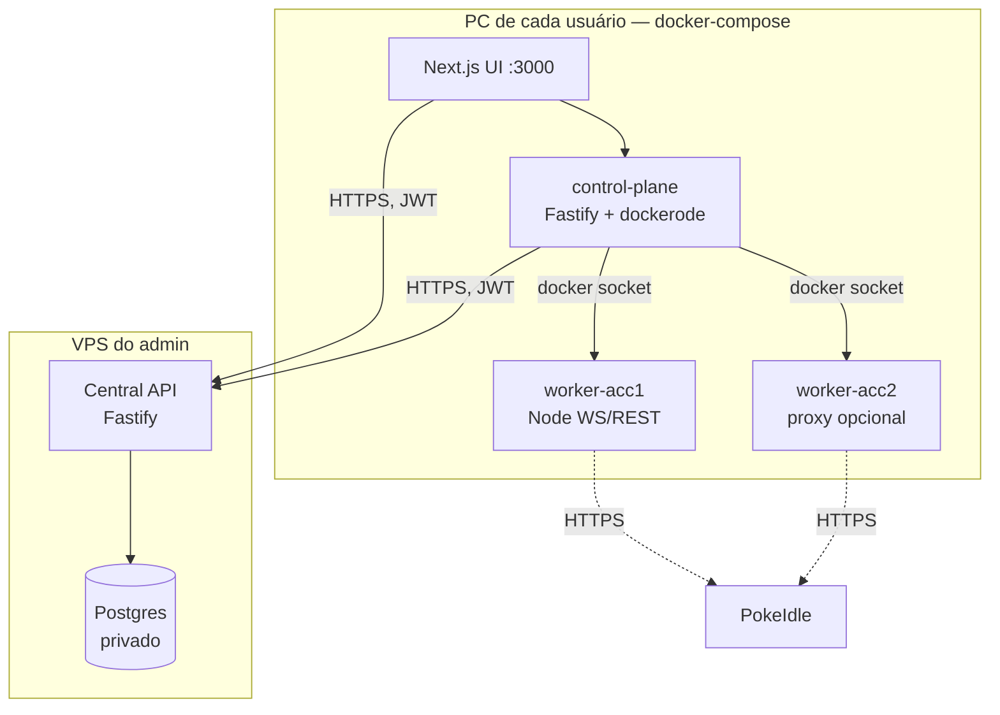

# Multiacc PokeIdle — Design

Data: 2026-10-11
Status: Aprovado

## Objetivo

Aplicação distribuída para rodar múltiplas contas do PokeIdle em containers Docker com automação total (bot Playwright). Cada usuário roda o pacote completo localmente (UI + control-plane + workers) via `docker-compose`; dados, auth e versionamento vivem numa infra central (VPS do administrador) com API + PostgreSQL.

## Requisitos consolidados

- Automação total: bot Playwright joga sem intervenção manual
- Escala sem teto artificial: orquestração via Docker API, não compose estático
- Proxy opcional por conta (PokeIdle limita 4 contas/IP)
- Distribuível para amigos: cada um roda o compose local, autentica no central, vê só as próprias contas
- Updates centralizados: administrador publica imagem nova, clients recebem (automático + disparo manual + rollback)
- Zero banco de dados local: tudo no Postgres central atrás da API

## Arquitetura

### Componentes

**Central API (VPS)** — Fastify + Postgres privado. Responsabilidades: auth (JWT access 15min + refresh 30d), CRUD multi-tenant de contas PokeIdle, endpoint de versão/release. Senhas PokeIdle criptografadas em repouso (AES-256-GCM, chave em env var).

**UI (local)** — Next.js App Router + Tailwind. Telas: login, dashboard de contas (status, última ação, uptime, start/stop/restart, logs via SSE), form de conta (credenciais + proxy com teste), updates (badge, changelog, atualizar/rollback, toggle automático).

**Control-plane (local)** — Fastify + dockerode. Valida JWT em todo endpoint, busca configs no central (cache em memória), cria/destroi/reinicia workers via Docker socket, executa updates (pull + rolling recreate + updater efêmero para si mesmo e a UI), health-check e backoff de workers.

**Worker (efêmero, nunca no compose)** — `node:22-slim`, **sem browser**: cliente WS/REST puro (`ws` + `fetch`), ~50 MB RAM por conta. O jogo é server-authoritative (Socket.IO + REST `/api/game/*`, ver `packages/worker/GAME.md`). Recebe config por env vars; healthcheck HTTP local + logs JSON no stdout; drain gracioso em SIGTERM. Não tem credencial nenhuma do central.

**Login (interface `TokenProvider`, estratégia trocável):**
1. **Solver Turnstile** (primária): chave de API 2captcha-compatível por conta ou global; worker resolve o Turnstile e faz `POST /api/auth/login` sozinho
2. **Token colado** (fallback): usuário loga no browser normal, copia `sessionStorage['pokeweb:tokens']` e cola na UI; tokens ficam criptografados no central
- Refresh automático via `/api/auth/refresh` (sem CAPTCHA); tokens renovados são persistidos de volta no central pelo control-plane
- Sessão derrubada (WS close 4001) ou refresh expirado → worker marca `needs-login` e a UI pede nova ação (solver ou cola)

### Orquestração

Workers criados dinamicamente via dockerode com nome `mpw-worker-<accountId>`, labels de rastreio, restart com backoff exponencial (1m→15m) gerenciado pelo control-plane. Compose declara apenas `web` e `control-plane`.

## Fluxos

### Auth

Login na UI local → control-plane → central → access JWT (15min) + refresh (30d, arquivo de volume local). Grace offline de 7 dias no refresh; expirado, UI entra em read-only. Workers rodando nunca são derrubados por auth. Revogação efetiva no próximo refresh.

### Update

Control-plane consulta `GET /version` no boot e a cada 6h. Automático ligado: pull da imagem nova, recreate rolling de workers (SIGTERM drain), updater efêmero recria control-plane + UI e se autodestrói. Manual: badge na UI. Compose referencia `:stable`; digest exato registrado para rollback em um clique. Workers e control-plane versionam independente (env var contract versionado).

## Modelo de dados central

| Tabela | Colunas |
|---|---|
| `users` | id, username, password_hash, role (admin/user), active |
| `refresh_tokens` | id, user_id, token_hash, expires_at, revoked_at |
| `accounts` | id, user_id, label, pokeidle_user, pokeidle_pass_enc, access_token_enc, refresh_token_enc, proxy_url, solver_key_enc, created_at |
| `releases` | id, version, channel, image_digest, changelog, published_at |

## Erros por design

- VPS fora → grace 7 dias; workers seguem; sem start/config novo
- GHCR falhou → mantém imagem atual, retry com backoff, badge de erro
- Docker socket indisponível → UI mostra "Docker não responde"
- Worker crash-loop → backoff + flag na UI após 3 falhas
- Update quebrado → rollback por digest

## Testes (Vitest)

- Unit: game loop vs DOM mockado, parser de versão, grace de auth
- Integração: control-plane vs Docker real (DinD no CI); central API vs Postgres de teste
- E2E smoke: compose sobe, login com usuário de teste, conta fake, worker com imagem `mpw-worker-mock` (CI não depende do PokeIdle)

## Riscos

- **Solver Turnstile é aposta não validada**: 2captcha e afins anunciam suporte a Turnstile, mas só a Task 19 (integração real) prova. Se falhar, fallback de token colado já está no design e a troca de estratégia é localizada (interface `TokenProvider`)
- **Lógica do game loop depende do protocolo WS/REST do Poke Idle World** (parcialmente mapeado no GAME.md; eventos/endpoints completos só em runtime) — isolada em módulo `game/` no worker, trocável sem tocar infra
- VPS é dependência dura para start/config (decisão do usuário: sem banco local).
- Termos de serviço do PokeIdle: automação pode violar ToS; risco assumido pelo usuário.
